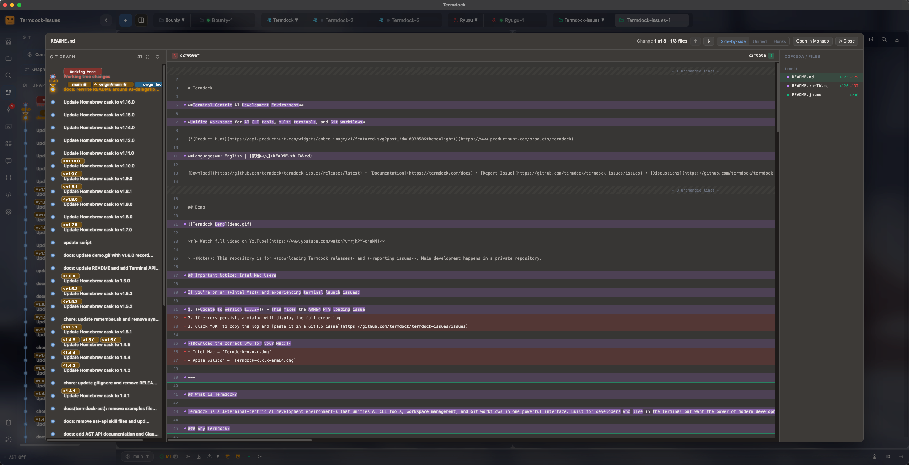
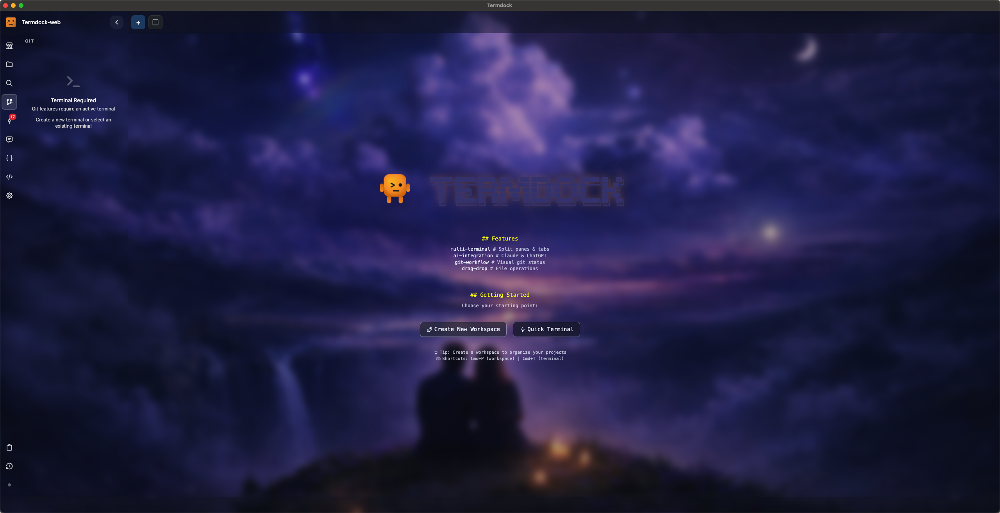
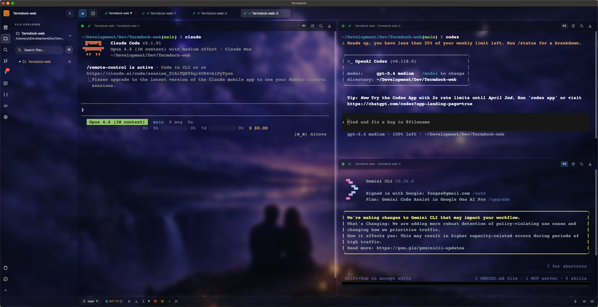
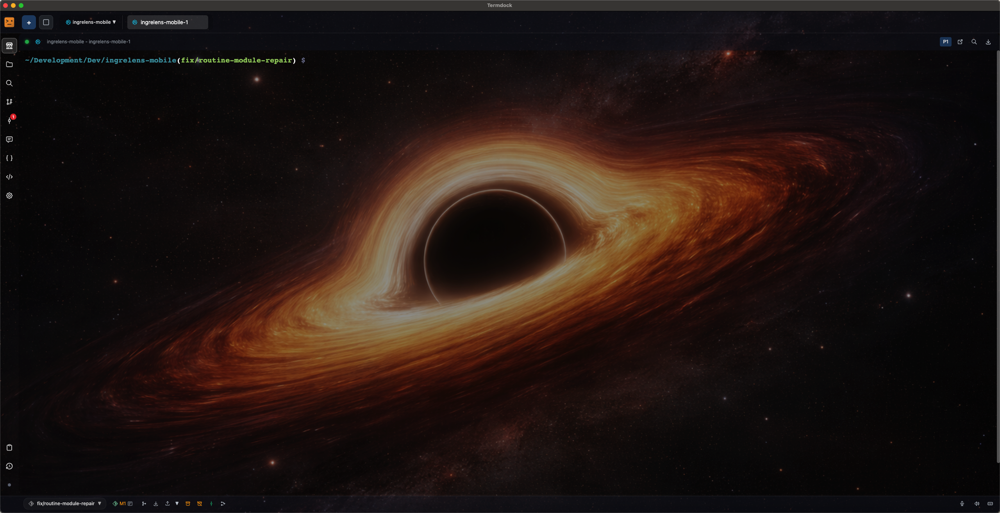

<div align="center">

# Termdock

**An AI terminal for Claude Code, Codex, Antigravity CLI (agy), and other coding agents.**

Run agents side by side in a desktop workspace, connect computers, review Git changes, and use terminal sessions from your phone. Termdock is available for macOS and Windows.

[](https://www.producthunt.com/products/termdock)

**Languages**: English | [繁體中文](README.zh-TW.md) | [日本語](README.ja.md)

[Download](https://github.com/termdock/termdock-issues/releases/latest) • [Documentation](https://termdock.com/docs) • [Report Issue](https://github.com/termdock/termdock-issues/issues) • [Discussions](https://github.com/termdock/termdock-issues/discussions)

</div>

---

> **About this repository:** Download releases, report issues, and join discussions here. The Termdock application is developed in a private repository.

## Demo

[View the animated demo (92 MB)](demo.gif) · [Watch the demo on YouTube](https://www.youtube.com/watch?v=rjkPY-c4eMM)

---

## What is Termdock?

Termdock combines a terminal emulator, AI agent sessions, remote workspaces, and Git review in one desktop app. Use your own installed agents and accounts; model subscriptions are separate. Customize the workspace with your own background, themes, and fonts.

### Why Termdock?

- **Run AI coding tools side by side:** Use Claude Code, Codex, Antigravity CLI (agy), OpenCode, and GitLab Duo in terminal sessions.
- **Connect computers:** Pair Termdock devices to work in shared peer workspaces, or connect to an SSH server using the beta integration.
- **Keep work running:** Local and peer terminals can continue through app restarts while their host remains running and signed in. SSH terminals end with the app.
- **Review agent changes:** Inspect Git diffs and use the code graph to explore affected callers.
- **Use a phone browser:** Pair on a trusted network to read terminal output and send input. The desktop Workstream panel is not available in the browser.
- **Make the terminal yours:** Choose themes, fonts, and background images.

---

## Get started

1. [Download the latest release](https://github.com/termdock/termdock-issues/releases/latest) for macOS or Windows and install it.
2. Install and sign in to the AI CLI tools you want to use. Termdock does not include their accounts or subscriptions.
3. Open a project folder as a workspace, create a terminal, and start your agent. See the [getting started guide](https://termdock.com/docs/getting-started).

For version-specific changes, see the [latest release notes](https://github.com/termdock/termdock-issues/releases/latest).

---

## Screenshots

<div align="center">

### Visual Git Review
*Three-pane diff review with blame, cross-file navigation, and Twin Focus token highlighting*



### Workspace Welcome Screen
*Start a workspace or open a terminal.*



### Multi-Terminal Workspace
*Terminals, file previews, repositories, and AI agents in one unified grid*



### Theme Customization
*Dark mode, light mode, custom backgrounds and fonts — your terminal, your view*



</div>

---

## Features

### Run Claude Code, Codex, and Other AI Agents

Run supported agents such as **Claude Code, Codex, Antigravity CLI (agy), OpenCode, and GitLab Duo** in managed terminal sessions. Other command-line tools can also run in a terminal; agent-specific integrations vary by provider. In v1.24, Antigravity CLI uses a terminal-backed session, and the Agent Sessions API does not support resume or attach for it.

- **Agent Workstream:** After setting up hooks for a supported agent, review permission requests, questions, and plans in the desktop panel. See the [CLI guide](https://termdock.com/docs/cli) for setup.
- **Terminal API** — a local HTTP API for agents and scripts: create, control, and read terminal sessions (including headless ones), stream output in real time via SSE, authenticate with service tokens and rate limiting. [API Documentation](https://termdock.com/docs/terminal-api)
- **`termdock` CLI:** On macOS, install the command-line tool to create, attach, and follow sessions from shell scripts. Windows users can use the desktop app and local HTTP Terminal API; the one-click CLI installer is macOS-only.
- **Voice input** via Whisper, **AI-generated commit messages** (BYOK), and installable **Claude Code Skills** for Termdock's AST and Terminal APIs

### Own the View

The agents may write the code, but the screen you stare at eight hours a day is yours. Put **your own image behind your terminal** — Termdock tints an automatic readability scrim from the picture's own colors, so the text stays crisp and the art stays visible.

- **Dynamic theme system** — dark mode, light mode, and per-theme accent colors across the entire app
- **Custom terminal fonts** — including custom font search paths beyond system locations
- **Translucent glass chrome** — unified across terminal panes and in-pane file viewers
- **Discord Rich Presence** — show Termdock activity in your Discord status

### A Terminal That Stays Fast

Agents produce a firehose of output. Termdock renders it with **WebGL (GPU)** instead of laying out every cell in the DOM — renderer CPU under heavy output drops by roughly 90% — and an **automatic power-saving mode** dials things back on battery and lets the GPU loose when you're plugged in.

- **Session persistence:** Local and peer terminals can keep running through app quits, crashes, and updates while the host remains running and signed in. SSH terminals end with the app.
- **Split panes & tabs** — horizontal (Cmd+D) and vertical (Cmd+Shift+D) splits, drag-and-drop reordering, quick switching (Cmd+1–9), picture-in-picture mode
- **Dock parking** — drag a terminal you're not watching into the dock: no pane, no tab-strip slot, notifications keep piling up, and it's ready whenever you are
- **Background & headless terminals** — long-running shells keep full screen state without a visible pane

### Output You Can Actually Click

Every command's output range and working directory are tracked through shell integration (OSC 133), so file paths in your output just work: git diff prefixes are cleaned up, wrapped long paths are reassembled, and relative paths resolve against the directory the command actually ran in.

- **Listening port badges** — see which ports your workspace services are listening on, live in the sidebar, no more `lsof`
- **Host detection** — Termdock knows whether each session is local, over SSH, or inside a container

### Verify What the AI Wrote

"Done!" says the agent. Termdock helps you check. A **native Rust indexing pipeline** builds a code graph that goes beyond functions and classes — it understands your web framework — and maps any diff back to its blast radius.

- **Diff impact analysis** — a git diff maps onto the code graph and walks back to affected callers, so you know what the agent's change actually touches before you accept it
- **Framework route nodes** — routes in Express, Fastify, Koa, FastAPI, and Flask become first-class graph nodes, traceable from route to handler to middleware
- **Tree-sitter + LSP** across **13+ languages** — JavaScript, TypeScript, Python, Rust, Go, C, C++, Java, Ruby, PHP, Swift, and more
- **Code Graph MCP server** — expose your codebase structure to Claude Code, Codex, Cursor, and any MCP-compatible tool

### Review Git Where You Work

The final check before you ship what the agent built — without bouncing to a browser. Termdock ships a **visual Git review surface**: three-pane layout with blame, cross-file navigation, and smooth handling of large files.

- **Twin Focus** — corresponding tokens highlight on both sides at once, so renames line up at a glance
- **Read-only merge / conflict review**, visual branch management, and colors that follow your theme

### Workspaces Without Ceremony

Drop a folder onto Termdock and you have a workspace. Tag it, and the sidebar and quick switcher (Cmd+P) group everything automatically.

- **File previews inside panes** — Markdown, code, JSON/YAML/XML, PDF, and images open in the same grid as terminals, with the same tabs and drag-and-drop rules
- Full-featured file explorer, fuzzy search with `*`/`?` wildcards, Markdown export to standalone HTML

### Work Across Machines

Your projects don't all live on one computer. Termdock mounts remote workspaces next to local ones — same grid, same tabs, same shortcuts.

- **LAN Peer Remote** — devices on the same network discover each other automatically; pair once, stay trusted, and mount shared workspaces over an end-to-end encrypted channel with no cloud relay
- **SSH Remote Workspaces (Beta):** Connect to an SSH-reachable server and open its terminals in Termdock. SSH terminals end when the app closes.
- **Reconnect:** Brief disconnects can reconnect. The host computer must stay running and signed in for background terminals to persist.
- **Host stays in control** — sharing is off until enabled in Settings, unsafe roots are rejected, and inbound sessions are visible and individually terminable

### Use a Phone or Browser

Pair a phone or desktop browser on a trusted network to view and send input to local terminals. Browser access uses HTTP; use a trusted network and configure a VPN such as Tailscale for access from outside it. Browser clients do not include the desktop Workstream approval panel. [Browser access guide](https://termdock.com/docs/browser-access)

Termdock also supports remote terminal input, output, notifications, and screenshots through **Telegram or Discord**. [Remote control guide](https://termdock.com/docs/remote-control)

---

## Roadmap and Releases

The [roadmap](https://termdock.com/roadmap) describes longer-term plans and may lag behind the latest release. For shipped features, check the [release notes](https://github.com/termdock/termdock-issues/releases). Share ideas in [Discussions](https://github.com/termdock/termdock-issues/discussions).

---

## Download & Installation

### macOS — Homebrew (Recommended)

```bash
brew tap termdock/termdock-issues https://github.com/termdock/termdock-issues
brew install --cask termdock
```

### Manual Download

**Latest Release**: [Download Here](https://github.com/termdock/termdock-issues/releases/latest)

| Platform | File |
|---|---|
| macOS (Apple Silicon, recommended) | `Termdock-x.x.x-arm64.dmg` |
| macOS (Intel) | `Termdock-x.x.x.dmg` |
| Windows | `.exe` installer in the latest release |
| Linux | No public installer yet |

**macOS minimum:** macOS 12.0 or later, with an Intel or Apple Silicon Mac.

**macOS Installation**
1. Download the appropriate DMG for your Mac
2. Open the DMG file and drag Termdock to Applications folder
3. If macOS blocks the first launch, review the security message and confirm the release source before allowing it.

**Windows installation:** Download the `.exe` installer from the latest release, run it, and follow the setup prompts.

If the app or a terminal fails to start, include your Termdock version, operating system, and error details when [reporting an issue](https://github.com/termdock/termdock-issues/issues).

---

## Bug Reports & Feature Requests

Found a bug or have an idea? We'd love to hear from you!

[**Create an Issue**](https://github.com/termdock/termdock-issues/issues) | [**Start a Discussion**](https://github.com/termdock/termdock-issues/discussions)

### Before Reporting

- Check if the issue already exists
- Try the latest version
- Include:
  - OS and version (macOS / Windows)
  - Termdock version
  - Steps to reproduce
  - Error logs (if applicable)

---

## Community & Support

- **Issues**: [GitHub Issues](https://github.com/termdock/termdock-issues/issues)
- **Discussions**: [GitHub Discussions](https://github.com/termdock/termdock-issues/discussions)
- **Documentation**: [termdock.com/docs](https://termdock.com/docs)
- **Website**: [termdock.com](https://termdock.com)

---

## Stay Updated

Follow this repository to get notified of new releases:
1. Click **Watch** at the top
2. Select **Custom** → **Releases**

---

<div align="center">

**Termdock — let AI write the code; the view stays yours**

For developers who delegate the work, not the taste

[Website](https://termdock.com) • [Download](https://github.com/termdock/termdock-issues/releases/latest) • [Docs](https://termdock.com/docs)

</div>
